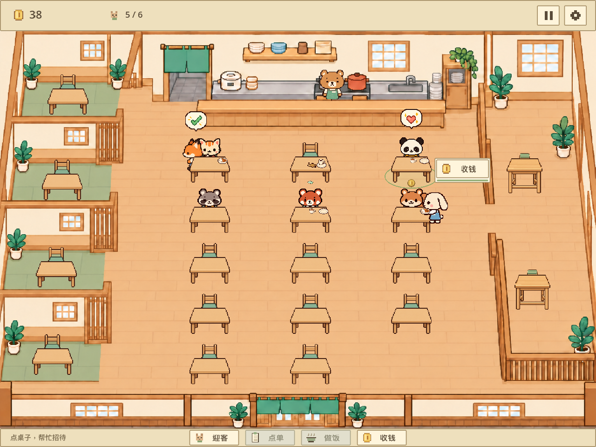
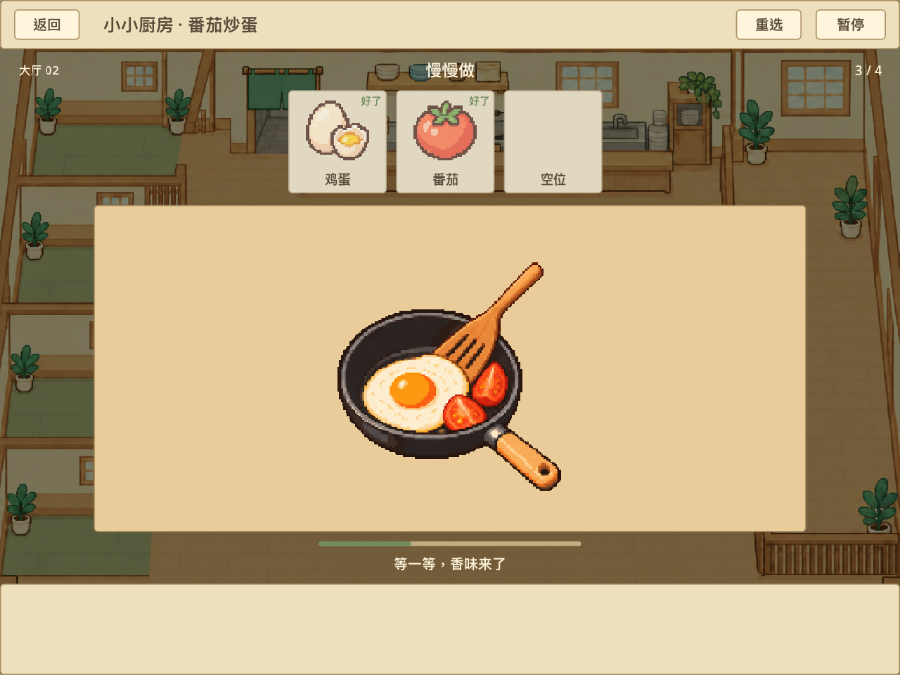

# 小森食堂（Kitchen Game）

一个离线运行的 Godot 餐厅经营与做菜小游戏。大厅、包厢和吧台共 **20 桌**；**17 种顾客**会轮换入店，兔子与狐狸负责服务，熊是餐厅主理人。

本项目已使用 **Godot 4.5.1** 验证。下载仓库后，请用官方 Godot 编辑器导入根目录的 `project.godot`，按 **F5** 运行；也可以在根目录执行：

```sh
godot --path .
```

`启动游戏.command` 是原开发机的辅助脚本，其中包含本机引擎路径；其他机器请使用以上标准 Godot 方式启动。本次发布不修改该脚本。

## 玩法

顾客入座后，点击顾客或桌子确认订单并进入厨房。订单固定对应配方，不能在厨房中改成另一道菜：

| 配方 | 材料与流程 |
| --- | --- |
| 土豆胡萝卜汤 | 土豆、胡萝卜和单独添加的水；切块、入汤锅、选火、等待、盛出。 |
| 番茄炒蛋 | 鸡蛋、番茄；切番茄、入炒锅、选火、等待、翻炒完成。 |
| 芝士烤吐司 | 面包、芝士；入烤箱、等待、取出。 |
| 冰拿铁 | 咖啡、牛奶、冰块；按顺序加入并搅拌。 |

进入厨房时，大厅营业会暂停：迎客、耐心、寻路、服务任务和营业计时不会推进。完成料理后自动恢复营业；服务员会自动送餐、送饮料，顾客随后结账、离店并由系统清桌。

加热完成后有 12 秒收尾窗口，超时可温和重试且不扣金币。“再试试”保留已准备的食材和步骤；“重选”清空本次准备，重新制作同一份订单。厨房中选择“返回”或按 **Esc** 会取消本次准备：订单保留，但已操作的食材不保留。

## 操作

- **空格**：在大厅对已选顾客点单或进入制作；厨房中不会触发隐藏的大厅操作。
- **P** 或顶部暂停：暂停/恢复当前界面；厨房中只暂停小游戏。
- **Esc**：大厅中优先关闭设置或 F3 面板，否则暂停/恢复；厨房中返回大厅并取消本次准备。
- **S** 或“保存进度”：手动保存；游戏也会每 3 秒自动保存。
- **F3**：显示/隐藏开发面板（订单、队列和任务），正常游玩不需要。

## 厨房动画与截图

新增动画的映射如下：

- 汤的加水：`pour_water`（单次播放）。
- 汤的切菜：`chop`（单次播放）。
- 煮汤阶段：`stir`（循环）。
- 番茄炒蛋的烹饪阶段：`stir_fry`（循环）。

烤吐司和冰拿铁仍使用静态画面。番茄切菜尚未接入动态素材，不复用土豆胡萝卜的切菜动画。





其他可用截图：[倒水](verification/cooking_animation_pour_water.png)、[切菜](verification/cooking_animation_chop.png)、[煮汤](verification/cooking_animation_soup_loop.png)、[烤吐司](verification/cooking_animation_oven_static.png)、[冰拿铁](verification/cooking_animation_drink_static.png)。

## 存档

当前正常多桌存档格式为 **V4**，默认文件为 `user://restaurant_multi_save_v2.json`。它保存桌位、顾客、服务任务、金币、订单和厨房当前步骤等状态；旧 V3/V2 存档可按兼容规则读取。一桌版 `restaurant_save_v1.json` 不会自动读取、迁移或覆盖。

## 已完成验收记录

以下为已有验收结果，并非本次文档整理重新执行的测试。GUI 断言总数可能随实际渲染帧数变化。

| 测试 | 已记录结果 |
| --- | --- |
| `test_cooking_animation.gd` | 46 项断言，0 失败 |
| `test_cooking_session.gd` | 690 项断言，0 失败 |
| `test_cooking_integration.gd` | 225 项断言，0 失败 |
| `test_cooking_animation_ui.gd` | 2255 项断言，0 失败 |
| `test_cooking_ui.gd` | 2547 项断言，0 失败 |

可在无图形环境中执行新增动画测试：

```sh
godot --headless --path . -s tests/test_cooking_animation.gd
```

GUI 测试需要图形环境。`tests/static_check.py` 是旧版静态检查，不是当前的总验收入口。

## 音乐与素材说明

游戏为离线运行，不连接云端 AI 或 LLM。配乐《木漏日厨房》为原创程序合成音乐；来源说明见 [`assets/audio/SOURCE.md`](assets/audio/SOURCE.md)。项目不在此声明任何第三方素材或版权的授权状态。
